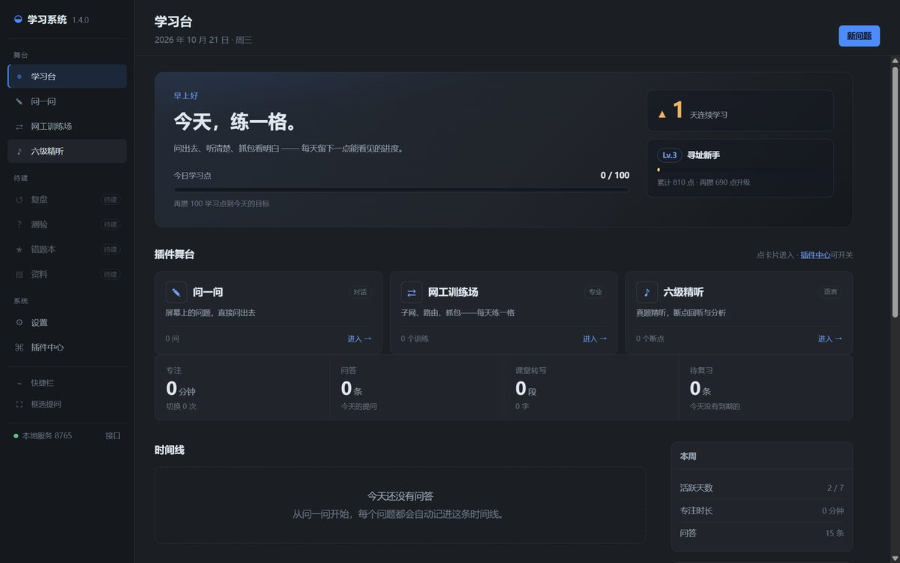
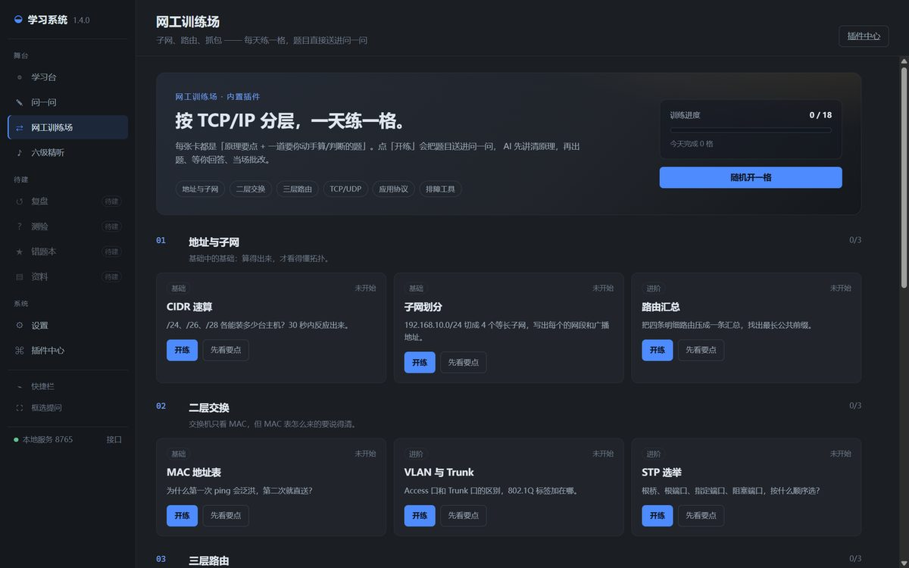
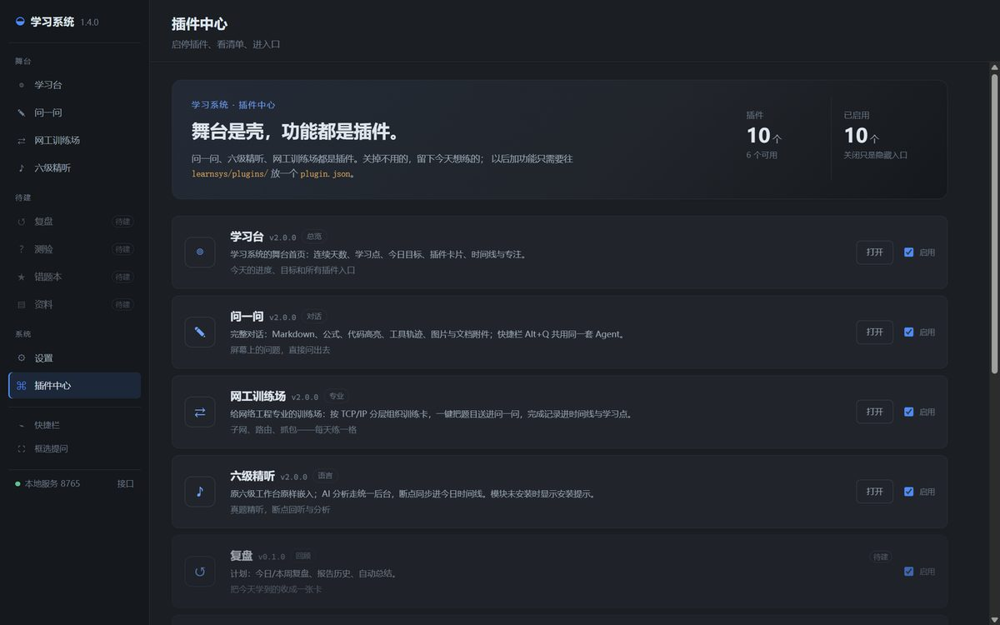

# 学习系统 · learnsys

> **一个本地优先的学习舞台。** 问一问、六级精听、网工训练场都是插件；
> 学习台负责把进度、连续天数、学习点和插件入口摆在一张桌上。
> 版本 **2.0.0** ｜ Windows 11 实测 ｜ MIT License



## 一分钟看懂

- **舞台**：浏览器里的「学习台」—— 今日学习点、连续天数、等级、插件卡片、时间线、专注、成就。
- **插件**：每个功能一个清单 `learnsys/plugins/<id>/plugin.json`，可开关、可替换、可新增。
- **本地**：Agent 直连模型（不再依赖 Codex）；问答、转写、进度都在本机 `learning.db`。
- **快捷栏**：`Alt+Q` 框一块屏幕直接问 AI，答案出在屏幕顶上的横栏里。

## 30 秒上手

1. 双击 `问一问.cmd`（有打包版就启动 `dist\问一问\问一问.exe`）。浏览器自动打开学习台。
2. 第一次用会看到「三步跑起来」引导：去设置页填模型；没有 key 时先用训练场/六级离线功能。
3. 侧栏选插件：
   - **问一问**：打字提问；或按 `Alt+Q` 框选屏幕。
   - **网工训练场**：按 TCP/IP 分层练一格，题目自动填进问一问。
   - **六级精听**：真题精听、断点回听、AI 分析。
4. 进度会变成学习点：问答 10 / 转写 5 / 六级断点 8 / 网工训练 15 / 复盘 25 / 测验 20 / 专注 1 分钟 1 / 收藏 3。

## 内置插件

| 插件 | 类型 | 状态 | 入口 | 说明 |
| --- | --- | --- | --- | --- |
| 学习台 | 原生页 | 可用 | `#/today` | 舞台首页：学习点、等级、连续天数、插件卡片、时间线 |
| 问一问 | 原生页 | 可用 | `#/ask` | 完整对话：Markdown / 公式 / 代码 / 工具轨迹 / 图片文档 |
| 网工训练场 | 原生页 | 可用 | `#/netlab` | 6 条主线 × 3 张训练卡；开练 = 记进度 + 题目送进问一问 |
| 六级精听 | iframe | 可用（可选模块） | `/cet6/` | 原工作台原样嵌入；AI 分析走统一后台；断点进时间线 |
| 复盘 | 原生页 | 可用 | `#/review` | 今日记录 → AI 复盘卡片；+25 学习点 |
| 测验 | 原生页 | 可用 | `#/quiz` | 按今日记录出 5 题，逐题批改；+20 学习点 |
| 错题本 / 资料 | 原生页 | 待建 | `#/wrongbook` 等 | 后续插件，清单里已占位 |
| 设置 / 插件中心 | 原生页 | 可用 | `#/settings`、`#/plugins` | 模型密钥、插件开关、数据与备份 |




## 学习点与成长

| 行为 | 学习点 |
| --- | --- |
| 一条问答 | 10 |
| 一段课堂转写 | 5 |
| 一条六级断点 | 8 |
| 完成一格网工训练 | 15 |
| 完成一次复盘 | 25 |
| 开始一场测验 | 20 |
| 专注 1 分钟 | 1 |
| 收藏一条问答 | 3 |

- 每天目标默认 **100 学习点**，可在 `设置.json` 改 `daily_goal_xp`。
- 等级按累计学习点：`网络小白 → 布线学徒 → 寻址新手 → 路由行者 → 抓包侦探 → 协议解剖师 → 拓扑架构师 → 网络工程专家`。
- 连续天数：当天有问答 / 转写 / 六级断点 / 网工训练 / 复盘 / 测验 / 录制任一项就算一天。
- 规则只在 `learnsys/server/routes_data.py` 的 `XP_RULES` 里定义一份。

## 问一问

- 横栏：`Alt+Q` 框选、拖动、收起成小条；固定几何，状态切换不跳。
- 工作台：完整对话、Markdown、公式、代码高亮、工具轨迹、停止、图片/文档附件。
- 同一个 Agent：横栏、工作台共用提示词、工具、记忆和记录。

## 网工训练场

给网络工程专业的主线训练：地址与子网、二层交换、三层路由、TCP/IP 传输、应用协议、排障工具。
每张卡有「原理要点」和一道要你动手算/判断的题；点「开练」会：

1. 写一条 `netlab` 学习事件（进时间线、加学习点）；
2. 跳到 `#/ask?prompt=...`，把题目预填进问一问；
3. AI 按提示先讲原理，再出题、等你回答、当场批改。

内容在 `web/js/pages/netlab.js` 的 `TRACKS` 里，加卡只改这一处。

## 复盘 / 测验

- **复盘**（`#/review`）：把今天的窗口摘要、课堂转写、问答、网工训练和六级断点交给 AI，
  输出「在学什么 / 5 个要点 / 哪里没学进去 / 10 分钟复习建议」。
- **测验**（`#/quiz`）：基于同一批今日记录出 5 道题（选择 + 简答），在页面里逐题作答、即时批改。
- 两者的内部提示词不记成「我问过什么」，会话也不混进问一问列表。

## 六级精听（可选模块）

- 默认找项目旁边的 `六级精听/`，也可以在 `设置.json` 填 `cet6_dir`，或设环境变量 `LEARNSYS_CET6_DIR`。
- 目录里要有 `工作台\精听工作台.html` 与 `试卷\`；没装时插件入口显示中文安装提示，不影响主功能。
- 旧 `file://` 工作台第一次打开会把 localStorage 进度推给后台，并自动下载 JSON 备份；
  HTTP 首开且本地为空时自动恢复。
- AI 分析走 `127.0.0.1:8765/analyze`，不需要再开「启动分析服务.bat」。

## 配置

设置文件：`D:\学习系统\设置.json`（首次启动自动生成模板；改完重启生效）。

| 键 | 作用 |
| --- | --- |
| `agent.base_url` / `auth_token` / `model` | 主模型（Anthropic Messages 兼容） |
| `agent.fast_model` / `max_tokens` / `thinking` | 快模型 / 输出上限 / 思考 |
| `vision.base_url` / `api_key` / `model` | 可选视觉模型；不填走 RapidOCR |
| `hotkey` | 框选热键，默认 `alt+q` |
| `daily_goal_xp` / `名字` | 每日学习点目标 / 学习台称呼 |
| `cet6_dir` | 六级精听目录（可选） |
| `modules` | 插件开关（插件中心会写这里） |
| `backup_dir` / `keep_days` | 自动备份位置 / 数据保留天数 |

主模型也可以走环境变量或 `~/.claude/settings.json` 的 `env`；设置页只回密钥尾号，不显示明文。

示例：

```json
{
  "agent": {
    "base_url": "https://api.deepseek.com/anthropic",
    "auth_token": "sk-你的key",
    "model": "deepseek-v4-pro",
    "fast_model": "deepseek-flash",
    "max_tokens": 8192
  },
  "vision": {
    "base_url": "https://open.bigmodel.cn/api/paas/v4",
    "api_key": "你的视觉服务key",
    "model": "glm-4v-flash"
  },
  "daily_goal_xp": 100,
  "名字": "智坚"
}
```

## 安装成独立应用（PWA）

学习台是一个可安装的 PWA，不需要改写成原生 app：

- 用 Edge / Chrome 打开学习台，侧栏出现「安装学习台」时点一下（或地址栏右侧的安装图标）。
- 安装后从开始菜单打开，是**独立窗口**，不显示地址栏/标签页；任务栏图标是学习系统自己的。
- Service Worker 只缓存页面壳，不缓存 API、六级 iframe 和音频；断网时仍能打开壳，并提示「后台未连接」。
- 不想安装也可以继续用 `问一问.cmd` 的 Edge 应用模式。

> 数据仍然来自本机 `127.0.0.1:8765`，所以「安装」不等于离线使用全部功能；断网只是壳还在。

## 数据与隐私

- 统一库：`learning.db`（问答 / 转写 / 会话 / 六级断点 / 事件）。
- 按天目录：`<数据目录>/2026.10.21/`（截图、录屏、报告等产物）。
- 数据目录优先级：环境变量 `LEARNSYS_DATA_ROOT` → 已有安装的 `D:\学习系统` → `%USERPROFILE%\学习系统`。
  换机器时设环境变量即可，历史数据不会丢。
- 服务只监听 `127.0.0.1`；写接口要随机令牌，跨源按 Origin 白名单拦截。
- 密钥只存本机设置文件；日志和接口回显都脱敏。备份会打包数据，但不会打包密钥。
- 六级真题音频与模型不进 Git；仓库 `.gitignore` 已排除。

## 从源码跑

```bat
python -m venv .venv
.venv\Scripts\pip install -r requirements.txt
.venv\Scripts\python -m learnsys.ask.app
```

只开后台（调试 Web 工作台）：

```bat
.venv\Scripts\python -m learnsys.server.app
```

打包：

```bat
.venv\Scripts\python -m PyInstaller --noconfirm --clean 问一问.spec
```

产物在 `dist\问一问\`，整个文件夹一起拷走就能用。

## 加一个插件

```
learnsys/plugins/myplugin/
└─ plugin.json        ← id / name / type / entry / order / status / home / tagline
```

- `type: "native-page"`：`entry` 指 `web/pages/*.html`，`script` 指 `web/js/pages/*.js`。
- `type: "iframe"`：`entry` 指后端挂载的 URL（例如 `/cet6/工作台/精听工作台.html`）。
- 插件写学习事件：`POST /api/events {module, kind, title, meta}`；读：`GET /api/events?module=...`。
- 详细字段、模板与约定见 [`docs/插件开发规范.md`](docs/插件开发规范.md)。

## 文档

- [`docs/学习系统-v2-架构方案.md`](docs/学习系统-v2-架构方案.md)
- [`docs/学习系统-v2-施工单.md`](docs/学习系统-v2-施工单.md)
- [`docs/P1-验收记录.md`](docs/P1-验收记录.md) / [P2](docs/P2-验收记录.md) / [P3](docs/P3-验收记录.md) / [P4](docs/P4-验收记录.md) / [P5](docs/P5-验收记录.md) / [PWA](docs/PWA-验收记录.md) / [P6](docs/P6-复盘与测验.md)
- [`docs/插件开发规范.md`](docs/插件开发规范.md)

## 贡献与安全

- [`CONTRIBUTING.md`](CONTRIBUTING.md)
- [`SECURITY.md`](SECURITY.md)
- [`THIRD_PARTY_NOTICES.md`](THIRD_PARTY_NOTICES.md)

## License

MIT
