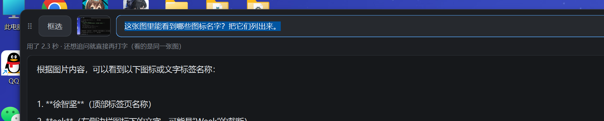

# 问一问 · learnsys

> **v2 开发中**：问一问已改为**独立 Agent 直连模型**，不再依赖 Codex；
> 看图走「视觉模型优先 + OCR 兜底」；浏览器工作台已可用（今日 / 问一问 / 六级精听 / 设置），
> 快捷栏固定几何 + 状态机已完成。
> 架构与施工单见 `docs/学习系统-v2-架构方案.md`、`docs/学习系统-v2-施工单.md`。

**框一块屏幕 → 问 AI → 答案就出在屏幕顶上那条横栏里。** 不用切窗口、不用去别处找它。



> v1.2 起内嵌了完整采集：**录制 = 系统声音转写 + 屏幕快照 + 窗口记录**，配合「复盘」「测验」形成学习闭环。

## 它能干什么

- **按 `Alt+Q`**（或点横栏上的「框选」）→ 屏幕变暗 → 拖一个矩形框住你想问的那块 → 打字 → 回车
- 答案就出在横栏里 —— **有多长就长多高**（上限约 62% 屏高，再长能滚），15px 大字
- **横栏就是程序本体**（没有别的窗口）：贴在屏幕上方、**能拖着挪**（位置记得住）、**能收成小条**（点一下又展开）
- **任务栏常驻**：有任务栏按钮、右键可「固定到任务栏」；托盘右键有「开机自启」
- **同时只会有一个**：再点一次不会冒第二个，只把横栏**叫回来**（收起 / 最小化 / Win+D 都叫得回来）
- **数据全在本地**：问答 / 转写 / 会话进统一库 `learning.db`；截图 / 录屏按天分在 `D:\学习系统\2026.10.2\`
- **截图用完就删** —— 收起 / 换一张 / 退出时清掉，盘上任何时候最多一张
- **录制**：录系统声音（不录麦克风）→ 本地 Whisper 转写；每 30 秒一张全屏快照；窗口记录 —— 三路一个会话
- **复盘 / 测验**：AI 根据今天的记录总结学习要点、出 5 道题考你（对话里逐题批改）
- **错题本**：问答一键收藏，托盘导出 Anki CSV；**每日报告 / 对话笔记** 一键导出 Markdown
- **专注统计 / 自动备份 / 数据清理**：托盘里全都有；启动时自动检查 GitHub 新版本
- 只把**你框的那块图**（或录制时的快照）交给 AI

## 快速开始

### 一、用打包好的 exe（最省事）

双击 `dist\问一问\问一问.exe` —— **整个 `dist\问一问\` 文件夹就是它**，拷到哪都能跑，不用装 Python。

### 二、从源码跑

```bat
python -m venv .venv
.venv\Scripts\pip install -r requirements.txt
.venv\Scripts\python -m learnsys.ask.app
```

（或者直接双击 `问一问.cmd` —— 它会优先用打包好的 exe，没打包才按上面这样从源码跑。）

我的环境：Windows 11 + Python 3.14 + PySide6 6.11.2（实测可用）。

## 接哪个 AI（v2）

v2 起「问一问」用**独立 Agent 直连模型**，不再依赖 Codex，也不要求本机开着任何中转口。

配置优先级：

1. `D:\学习系统\设置.json` 的 `agent` 段（开源版的正式入口）；
2. 环境变量 / `~/.claude/settings.json` 的 `env`（本机便利回退，免得同一把 key 填两处）；
3. 都没有 → 界面提示「还没配置模型」，不会抛一堆英文异常。

示例（第一次启动会自动生成模板，密钥留空）：

```json
{
  "agent": {
    "base_url": "https://api.deepseek.com/anthropic",
    "auth_token": "sk-你的key",
    "model": "deepseek-v4-pro",
    "fast_model": "deepseek-flash",
    "max_tokens": 8192
  },
  "vision": {
    "base_url": "https://open.bigmodel.cn/api/paas/v4",
    "api_key": "你的视觉服务key",
    "model": "glm-4v-flash"
  }
}
```

- **文本模型**：任何 Anthropic Messages 兼容服务（`/v1/messages`）。DeepSeek 直连已实测支持流式、工具调用、thinking。
- **视觉模型**：可选，任何 OpenAI 兼容的视觉服务（`/chat/completions` + `image_url`）。
- **没有视觉 key**：自动退回 RapidOCR，只读图中文字，并明确告诉你「这次没看到原图」；图表、箭头、颜色会弱。
- **DeepSeek 官方 API 不支持图片输入**（实测返回 `[Unsupported Image]`），所以看图要单独配视觉 key，或接受 OCR 兜底。

> 旧的 `api_base / api_key / api_model` 三项目前只被「学习报告 / 术语表」等旧路径使用，会在 v2 后续阶段迁移到同一个 Agent；问一问主问答已经不再读它们。

## 设置（都在 `D:\学习系统\设置.json`）

| 键 | 作用 |
| --- | --- |
| `agent.base_url` / `agent.auth_token` / `agent.model` | v2 主模型（Anthropic Messages 协议） |
| `agent.fast_model` / `agent.max_tokens` | 快模型 / 输出上限（默认 8192） |
| `vision.base_url` / `vision.api_key` / `vision.model` | 可选视觉模型（OpenAI 兼容）；不填就走 OCR |
| `hotkey` | 框选热键，默认 `alt+q` |
| `api_base` / `api_key` / `api_model` / `api_style` | 旧路径（学习报告 / 术语表）仍在使用，后续迁移 |

数据根固定在 `D:\学习系统`。v2 的记录统一进 `learning.db`，按天文件夹只放截图 / 录屏 / 报告。
想挪地方，改 `learnsys/config.py` 里的 `DATA_ROOT`；源码跑时横栏尺寸等参数也在那里调。

## 本地服务（v2）

v2 起，学习系统在 `127.0.0.1:8765` 起一个本地服务，Agent、数据、六级分析共用它：

```bat
.venv\Scripts\python.exe -m learnsys.server.app
```

- **浏览器工作台**：`http://127.0.0.1:8765/` —— 今日时间线、完整问答（Markdown / 公式 / 代码 / 工具轨迹）、设置
- 健康检查：`GET /api/health`（返回模型、令牌、数据库路径）
- 接口文档：`http://127.0.0.1:8765/docs`
- 写接口要 `X-Learnsys-Token`；跨源请求按 Origin 白名单拦截
- **六级精听**：`http://127.0.0.1:8765/cet6/`（可选模块）。把「六级精听」目录放到项目旁边，
  或在 `设置.json` 填 `cet6_dir`；没装时侧栏入口返回中文提示，不影响主功能
- 六级工作台的 `/analyze` 仍可用 —— 不用再单独开「启动分析服务.bat」；
  分析后的断点会同步进今日时间线，点条目带 `?paper=` 跳回该卷

正常双击启动时会自动起这个服务，不用手动开。

### 学习台窗口（v2）

双击「问一问」后会自动打开一个 **Edge / Chrome 应用窗口**：没有地址栏、没有标签页，
标题栏和任务栏显示「今日 · 学习系统」。关掉窗口程序仍在托盘，右键「打开学习台（独立窗口）」再开。

- **快捷栏 → 工作台**：快捷栏底部「工作台」按钮
- **工作台 → 快捷栏**：网页左侧「快捷栏」（叫回来）和「框选提问」（直接进入框选）
- 不想开机自动弹：在 `D:\学习系统\设置.json` 把 `workbench_on_start` 设为 `false`
- 端口 8765 被占时自动退到 8766；已有健康后台会直接复用

## 打包成自己的 exe

```bat
.venv\Scripts\pip install -r requirements-build.txt
```

然后双击 **`打包.cmd`**（第一次一两分钟）→ 出 `dist\问一问\问一问.exe`。

产物约 **520 MB**（Python、Qt、录音转写/OCR 依赖和浏览器工作台都打进去了）；exe 里写死了 `FileDescription = 问一问`
（`版本信息.txt`）—— 所以**任务栏固定出来就叫「问一问」、带自己的图标**，不会变成 Python。

## 固定到任务栏

1. 让问一问跑着（横栏在屏幕上）
2. 在任务栏上找到它的按钮 → **右键 →「固定到任务栏」**
3. 想开机自动起：托盘图标右键 →「开机自启（跟着电脑一起起来）」

## 目录里有什么

| 路径 | 干什么 |
| --- | --- |
| `learnsys/ask/app.py` | **入口**：托盘 + 全局热键 + 框选 → 横栏 |
| `learnsys/ask/bar.py` | **屏幕上那条横栏**（唯一的界面） |
| `learnsys/ask/overlay.py` | 全屏压暗 + 拖一个矩形框 |
| `learnsys/agent/` | **v2 独立 Agent**：配置、Anthropic 流式客户端、工具循环、提示词、视觉/OCR |
| `learnsys/ask/backend.py` | 旧协议分派（报告 / 术语表还在用；主问答已切到 `agent/`） |
| `tools/agent_cli.py` | 命令行跑一轮 Agent，验证模型接入（不启动界面） |
| `learnsys/ask/identity.py` | 自己的任务栏身份（图标 / AUMID / 开始菜单快捷方式） |
| `learnsys/ask/single.py` | 只留一个问一问：互斥体 + 本地套接字把横栏叫回来 |
| `learnsys/ask/icon.py` | 画那张图标（蓝底白「问」） |
| `learnsys/ask/usage.py` | 算本程序占了多少盘 |
| `learnsys/config.py` | 所有可调参数（数据根 / 热键 / 横栏尺寸…） |
| `问一问.py` · `问一问.spec` · `版本信息.txt` | 打包入口 + PyInstaller 配置 |
| `打包.cmd` | 双击就打包出 exe |
| `问一问.cmd` | 启动（优先用打包好的 exe） |
| `main.py` · `learnsys/asr.py` 等 | v1（录屏 + 听声 + 转写）还没整理，先别用 |

## 数据长什么样

```
D:\学习系统\
  设置.json            ← 你填 API key 的地方
  界面设置.json        ← 横栏的位置 / 收起状态（程序自己写）
  learning.db          ← v2 统一库：问答 / 转写 / 会话 / 六级断点（SQLite）
  2026.10.2\           ← 一天一个产物文件夹
    截图\              ← 临时截图（用完即删）
    问答截图\          ← 带图提问的归档截图
    录屏\              ← 录制时的屏幕快照
```

`learning.db` 里的 `asks` 表：`id, ts, question, answer, ms, backend, kind, image_path, thread, starred, ...`
—— **原始截图不塞进库，只记路径**；库里有全文索引，跨天也能搜。

### 从 v1（按天库）升级

```bat
.venv\Scripts\python.exe tools\migrate_v1_to_v2.py
```

只读旧的 `YYYY.M.D\learnsys.db`，写进 `learning.db`；重复跑会跳过已迁的源。
迁移前先备份整个 `D:\学习系统`。旧按天库不删，出问题可以回滚。

## 已知限制

- **没配视觉 key 时**：图片只能读 OCR 文字，图表/箭头/颜色会弱；回答会明确标注「没看到原图」。
- **旧路径**：学习报告 / 术语表仍走旧的 `api_*` 配置，v2 后续会并入同一个 Agent。
- 全局热键被别的程序占用时，托盘会弹提示（改 `hotkey` 即可）

## 许可

MIT —— 见 `LICENSE`。
